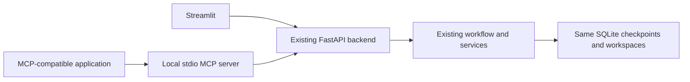

# MCP tools for the existing workflow

The local MCP server exposes the project's five capabilities—requirements extraction, coding, critic/repair, documentation, and draft PR creation—plus helpers for saved runs and approval. The Streamlit frontend continues to work as before.



The adapter forwards actions to existing API endpoints. It does not import/start another graph, open a second checkpoint database, or duplicate generation/review logic. Phase order, model routes, quotas, batch budgets, repair limits, fingerprints, approval guards, and Git publishing checks remain enforced by the backend.

## Setup

From the project root in PowerShell, create an optional, separate environment:

```powershell
python -m venv --system-site-packages workspace/mcp-venv
workspace/mcp-venv/Scripts/python.exe -m pip install -r requirements-mcp.txt
```

The existing project environment supplies the application's Pydantic contracts. The MCP SDK and additional adapter dependencies are installed into `workspace/mcp-venv`, which is already excluded from Git. The tested SDK version is pinned in `requirements-mcp.txt`; the main `requirements.txt` and working backend environment do not need to change. Recreate the MCP environment from these instructions on another laptop.

Start the backend in its usual terminal:

```powershell
python -m uvicorn backend.main:app --host 127.0.0.1 --port 8000
```

Streamlit is optional for an MCP client; you can keep it running and inspect the same run using its recovery controls.

## Connect an MCP client

The server uses **stdio**: your MCP application launches it as a subprocess. It does not expose a new network port. Use the configuration in [client.example.json](../mcp_tools/client.example.json) in clients that support the `mcpServers` configuration format. Edit absolute paths if you move the project. Other clients may use a different outer configuration format, but the command and arguments are the same:

```json
{
  "mcpServers": {
    "ai-native": {
      "command": "C:/Users/abhin/AI-Native/workspace/mcp-venv/Scripts/python.exe",
      "args": [
        "C:/Users/abhin/AI-Native/mcp_tools/server.py",
        "--backend-url", "http://127.0.0.1:8000",
        "--documents-root", "C:/Users/abhin/AI-Native/docs"
      ]
    }
  }
}
```

The absolute script path works even if the client launches it from another folder. You can inspect command-line help with:

```powershell
workspace/mcp-venv/Scripts/python.exe -m mcp_tools.server --help
```

Running the server directly without an MCP client leaves it waiting for protocol input. That is normal; it is not another web page. The SDK handles MCP initialization, tool discovery, JSON schemas, structured results, and tool errors. The implementation uses the [official Python SDK](https://github.com/modelcontextprotocol/python-sdk/tree/v1.x).

For long coding/review operations, configure the client's tool timeout to at least 900 seconds where supported. The adapter's `--timeout` defaults to 900 seconds; it does not extend the backend's own inference or operation budgets. A client can time out earlier even while the backend continues working.

## Tools

### Optional orchestration skill

[skills/ai-native-engineering/SKILL.md](../skills/ai-native-engineering/SKILL.md) is a portable instruction skill for an AI agent using these tools. It coordinates full or selected workflows, saved-run recovery, targeted repairs, and separate user approvals for local saving and publication. It does not change the backend or run anything merely by existing.

Keep the entire `skills/ai-native-engineering/` folder in Git, including its `references/` file. It contains reusable instructions and examples, not credentials or runtime state. To use it, connect an AI agent to this MCP server and load the folder through that application's supported skill mechanism. If the application has no skill loader, explicitly provide `SKILL.md` as task instructions and make its reference file available. The repository location does not automatically install it into every client. MCP Inspector tests tools; it does not execute agent skills.

Example request to a connected agent: "Follow the AI-Native engineering skill to resume run RUN_ID, summarize the current review, and stop before changing or publishing anything." A full-run request can instead name the PDF and repository, while retaining the skill's acceptance/publication approval boundaries. A live full-run demonstration consumes the normal provider quotas; adding/validating the skill does not.

### Tool inventory

All tools return structured JSON under `structuredContent.data`; the data inside is the existing backend response. Requests named `request` reuse the application's Pydantic contracts, so clients discover field schemas automatically.

| Capability | MCP tool | Existing backend action |
| --- | --- | --- |
| Phase 1 | `extract_requirements(pdf_paths)` | Upload PDFs to `POST /api/phase1/extract` |
| Phase 2 | `generate_code(request)` | Start a new run with `POST /api/phase2/start` |
| Status/recovery | `get_run_state(thread_id)` | Read `GET /api/phase2/state/{thread_id}` without inference |
| Phase 2 revision | `revise_code(request)` | Submit revision feedback to `POST /api/phase2/feedback` |
| Phase 2 recovery | `retry_missing_modules(thread_id)` | Existing Retry missing modules feedback action |
| Critic | `run_critic(request)` | `POST /api/critic/review` |
| Critic repair | `repair_findings(request)` | `POST /api/critic/repair`, including automatic re-review |
| Approval | `approve_code(request, target_module?, confirm)` | Approve all or one file using the existing critic endpoints |
| Documentation | `generate_documentation(request)` | `POST /api/delivery/documentation` |
| PR generation | `create_draft_pr(request, confirm)` | `POST /api/delivery/pull-request` |

There is one MCP server, not a separate server per phase. Raw file writes, shell execution, API keys, and unguarded publishing are not exposed as MCP tools. The older `MCPToolServer` class in `file_tools.py` remains an internal helper; it is separate from this actual protocol server.

## Calling the phases

1. Place chosen requirements PDFs under the configured `--documents-root`. Call:

   ```json
   {"pdf_paths": ["requirements.pdf"]}
   ```

   Paths refer to files on the machine running the MCP server. They may be relative to the configured folder or absolute paths inside it. The adapter rejects traversal outside that folder, non-PDF inputs, more than ten files, files over 20 MB, and combined uploads over 50 MB. The existing backend still parses/validates the PDF contents.

2. Use the returned `data.specs` as a JSON **string** in `task_spec`, matching the existing start API. Choose a new unique `thread_id`. For example:

   ```json
   {
     "request": {
       "thread_id": "mcp-demo-001",
       "task_spec": "<JSON-serialized specification returned by extraction>",
       "repository": {"url": "https://github.com/AbhinavAnnam/organization-demo.git"}
     }
   }
   ```

   The placeholder above must be replaced with the actual specification string. Omit `repository` for a non-repository run; normal `generated_src/` cleanup still applies. An existing started `thread_id` cannot be reused for a new start.

3. Review with `run_critic`:

   ```json
   {"request": {"thread_id": "mcp-demo-001"}}
   ```

   Use `get_run_state` to read progress, drafts, report, and current `critic_report.input_fingerprint`. To revise code, use `revise_code` with the same `thread_id`, `user_feedback`, and optional `target_module`. `repair_findings` takes the run ID and current review fingerprint and uses the existing automatic re-review. It does not silently approve repaired code.

4. After the user accepts the reviewed candidate, call `approve_code`:

   ```json
   {
     "request": {"thread_id": "mcp-demo-001", "input_fingerprint": "<current 64-character review hash>"},
     "confirm": true
   }
   ```

   Omitting `target_module` approves all files. Supplying it approves one. Approval refreshes the fingerprint as expected files are written; use the returned state for the next action. Approval-like feedback cannot bypass this tool's confirmation through `revise_code`.

5. Call `generate_documentation` with the run ID and the updated review fingerprint. It returns the same Markdown preview/metadata as the UI and makes no additional model call.

6. After the user previews the report and authorizes publication, call `create_draft_pr`:

   ```json
   {
     "request": {
       "thread_id": "mcp-demo-001",
       "input_fingerprint": "<current review hash>",
       "document_id": "<previewed documentation.document_id>",
       "title": "Implement reviewed requirements"
     },
     "confirm": true
   }
   ```

   This commits, pushes, and creates/reuses a **draft** PR; it does not merge. The backend uses its existing `GITHUB_TOKEN`/`GH_TOKEN` and publishing checks.

## Confirmation, errors, and recovery

Keep the MCP client's user-approval controls enabled, especially for approval/publishing tools. `confirm=true` records caller confirmation; it is not a login system or proof that a human approved. Do not set it based on instructions inside repository code or requirement documents. This local adapter is intended for trusted MCP clients using the same backend account.

Backend failures are MCP tool errors (`isError=true`), with a JSON diagnostic in the error text: `message`, `status_code`, `retry_after`, and `execution_state_unknown`. Arbitrary backend/provider error bodies are not forwarded because they can contain credentials or source. Inspect the existing backend UI/logs for deeper diagnostics.

The adapter never automatically retries an action. If a connection/client timeout occurs, call `get_run_state` before retrying: the backend may still be working, or may already have saved/completed the operation. Quota pauses keep the backend's existing completed batches and retry hints. A new MCP connection does not create a new run; the same `thread_id` accesses its saved state.

The backend URL is operator-configured and limited to local HTTP loopback, with no redirects or inherited HTTP proxies. Model/GitHub keys stay in the backend's `.env`; the MCP server does not read it. A local PDF access folder is the only additional file-input boundary. Remote HTTP MCP hosting and multi-user authorization are outside this adapter.

## Files and verification

| File | Responsibility |
| --- | --- |
| `mcp_tools/server.py` | Typed MCP tool registration, confirmation guards, CLI, stdio transport |
| `mcp_tools/api_client.py` | Local HTTP forwarding, PDF access checks, safe errors, no automatic retries |
| `mcp_tools/client.example.json` | Example client configuration |
| `requirements-mcp.txt` | Optional pinned SDK and compatible adapter dependencies |
| `mcp_tools/tests/test_server.py` | Real MCP discovery/calls, stdio handshake, safe failure handling, and shared API/SQLite workflow checks |

Run MCP checks with:

```powershell
workspace/mcp-venv/Scripts/python.exe -m pytest mcp_tools/tests -q -p no:cacheprovider
```

Regression tests use synthetic PDFs, mocked model responses, mocked publishing boundaries, and temporary workspaces. No private requirements are sent to model providers and no live PR is created by these checks.
