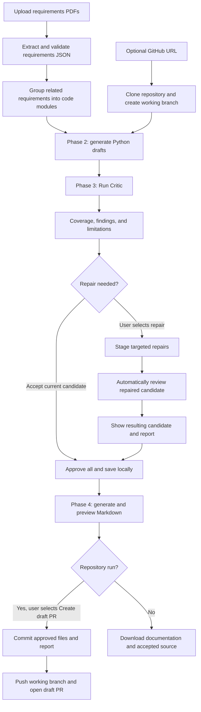

# AI-Native: workflow and file guide

This is the plain-language map of the project as implemented on 21 October 2026. Start with sections 1–4 to understand the flow; use the file tables when opening the code. [README](../README.md) contains setup and configuration details; [architecture.md](architecture.md) records deeper implementation decisions.

## 1. What this project does

You supply a requirements PDF and, optionally, a GitHub repository URL. The application extracts requirements, generates Python drafts, reviews them against those requirements, offers targeted repairs, and lets you accept the resulting candidate. It then creates a Markdown change report and can publish a draft pull request.

There are four user-facing phases:

| Phase | Input | Main output | What you do |
| --- | --- | --- | --- |
| 1. Requirements | Text-based PDF documents | Validated requirements JSON | Upload documents and extract specifications |
| 2. Coder | Requirements JSON and optional existing repository | Draft Python modules | Start generation; optionally request revisions |
| 3. Critic and repair | Requirements plus current draft code and relevant repository context | Coverage report, findings, and optionally repaired drafts | Run Critic; repair if needed; approve the project |
| 4. Documentation and PR | Accepted code, current critic report, repository baseline | Markdown report and optional GitHub draft PR | Generate/preview documentation; explicitly publish |

The dedicated **tester agent was intentionally skipped**. Our own `tests/` folder tests this tool's implementation; it is not a tester agent that generates tests for your target application.



Buttons initiate work; opening a tab or polling progress does not automatically request another model generation. External provider failures can pause a step. Saved work lets you continue the same run.

## 2. The four layers of the application

| Layer | Location | Responsibility |
| --- | --- | --- |
| User interface | `frontend/app.py` | Displays tabs, uploads, drafts, findings, report previews, and action buttons |
| HTTP API | `backend/routers/` | Receives frontend requests, loads the run, checks prerequisites, and calls services |
| Workflow and services | `backend/agent/`, `backend/stages/`, `phase1_rag/`, `phase2_coder/` | Runs generation, review, repair, approval, documentation, and publishing logic |
| Contracts and integrations | `backend/models/`, `backend/tools/`, provider modules | Defines valid data and communicates with model APIs, Git, and GitHub |

For example, **Generate documentation** follows this path:

```text
frontend/app.py: delivery_action("documentation")
  -> POST /api/delivery/documentation
  -> backend/routers/delivery_router.py
  -> backend/stages/documentation.py: generate_documentation(...)
  -> save result in the run's SQLite checkpoint
  -> return structured JSON containing Markdown
  -> frontend displays the preview and download button
```

LangGraph manages code generation, revision, and approval state. Critic and delivery operations are called through their own routers and update the same persisted run. **The complete four-phase pipeline is not one giant LangGraph graph.**

## 3. What happens inside each phase

### Phase 1: PDF to requirements

1. The frontend uploads PDFs to `/api/phase1/extract`.
2. `extractor.py` reads selectable text, splits it into overlapping chunks, and optionally indexes those chunks in Chroma using the local embedder supplied by `deps.py`.
3. Model requests extract typed requirements from each chunk. Invalid or incomplete chunks cannot silently count as successful extraction.
4. `consolidation.py` merges validated chunk results locally. It preserves extracted facts and removes exact duplicates rather than asking another model to summarize away details.
5. `grouping.py` groups larger feature sets into 5–7 code modules. A small specification can legitimately contain fewer than five. The grouping model proposes feature IDs; local code copies the actual rules/functions/exceptions. Size or namespace conflicts can stop grouping rather than discard facts.
6. The final `ProjectSpecs` object is returned as JSON and displayed in the frontend.

The preservation checks protect facts **already extracted**. They cannot prove a model found every requirement in the original PDF. Scanned PDFs require OCR outside the current upload flow.

The final JSON contains `project_title`, `features`, and `cross_cutting_constraints`. Each feature has `feature_name`, `target_module`, `business_rules`, `functions` (signature and purpose), and `exceptions`.

**Why grouping exists:** many small extracted features should not necessarily become many separate model-generated files. Grouping keeps the coding workload manageable while retaining the extracted detail.

### Phase 2: requirements and repository to drafts

1. **Start Agent** sends the requirements and optional repository settings to `/api/phase2/start` with a `thread_id`.
2. For a repository run, the backend clones it into `workspace/<run_id>/repo/`, records its baseline commit, and creates `ai-native/<run_id>` as a separate local working branch.
3. Repository preparation selects existing Python files or proposes new paths. Explicit file mappings can override this selection. Related domains may be merged by the local planner.
4. `CoderAgent` receives module requirements, current source, and bounded repository context. It asks configured providers for complete Python source, checks syntax, and returns draft metadata.
5. Drafts are checkpointed and shown in Phase 2. The target repository files are not overwritten by ordinary draft generation.
6. File-specific feedback revises one module; project feedback can revise all modules. **Retry missing modules** preserves successful drafts and attempts only missing/invalid ones.

The coder is intended to modify existing code where appropriate and add files where needed. It uses selected context; it does not perform a guaranteed exhaustive audit of every repository file. Phase 3 supplies a separate requirements comparison.

For non-repository runs, new generation clears `generated_src/`. Approved repository clones are separate from that directory.

### Phase 3: critic, repair, and approval

1. **Run Critic** snapshots the requirements, candidate source, baseline, mappings, and relevant current disk context.
2. Requirements receive stable IDs. The review planner creates bounded scopes containing requirements and relevant source/dependencies. A review batch is a model request group, not a generated module.
3. Models return structured assessments. Local checks validate requirement IDs, file references, citations, and coverage. Unsupported claims are downgraded to uncertainty rather than treated as proven defects.
4. The report displays coverage (`met`, `partial`, `missing`, `unclear`) and findings (`defect`, `uncertain`, `suggestion`). The overall verdict is `pass`, `changes_requested`, or `needs_review`.
5. **Repair findings** targets confirmed defects and supported unmet module requirements. The existing coder generates proposed repairs; a dedicated repair provider adapter supplies bounded fallbacks.
6. Repaired files are staged in checkpoint state. They are reviewed automatically before becoming the authoritative candidate. Unaffected review results can be reused when their exact inputs remain compatible.
7. **Approve all & continue** accepts the reviewed candidate and writes files locally. Optional per-file approval remains available.

There is a two-round repair limit, with resumable progress for interrupted rounds. Repair does not guarantee a defect-free result. You can explicitly accept remaining findings; the documentation discloses them.

**What “current report” means:** the report is tied to an input fingerprint—a hash identifying the reviewed inputs. Editing code, specifications, or relevant disk context makes old evidence stale. The backend rechecks this before repair, approval, and delivery. Expected writes during approval refresh the fingerprint without another model call.

### Phase 4: documentation and draft PR

1. **Generate documentation** requires accepted files matching a complete, current critic report.
2. `documentation.py` compares accepted source against the baseline, calculates line changes, identifies added/removed/changed top-level Python functions/classes, and includes requirement coverage, findings, and limitations.
3. It produces `AI_NATIVE_REVIEW_<hash>.md`. The preview is stored in SQLite and can be downloaded. This step uses **no additional LLM call**.
4. **Create draft PR** revalidates the preview and candidate, writes the report into the clone, stages only approved mapped Python files and that report, then creates a local Git commit.
5. It pushes the working branch and calls GitHub to create a draft PR. The commit checkpoint and existing-PR lookup support retries after push/API failures without duplicate commits or PRs.

GitHub publishing uses `GITHUB_TOKEN` or `GH_TOKEN`, separately from model API keys. The report explicitly says automated tests were not run in this delivery workflow. PR creation does not merge changes.

Current publishing targets the repository URL you supplied. If you supply a fork, the automatic PR targets that fork. Opening a cross-fork PR against the original upstream repository is currently a manual GitHub step. Automatic fork creation and upstream PR targeting are not implemented.

## 4. Where your data and code live

| Location | Contents | Survives stopping backend/frontend? |
| --- | --- | --- |
| Browser/Streamlit session | Visible UI state, uploaded-file controls, Phase 1 extraction response before starting an agent run | Do not rely on this surviving a session loss |
| `workspace/checkpoints.sqlite` | Agent state: specifications once the coding run begins, drafts, critic reports/progress, staged repairs, approval status, documentation preview, publication checkpoint and PR result | Yes, while the database is retained |
| `workspace/<run_id>/repo/` | Actual local Git clone; original files initially, accepted changes after approval, report after publishing begins | Yes |
| `workspace/<run_id>/repository.json` | Repository setup metadata written during clone preparation | Yes; active evolving workflow state is in SQLite |
| `generated_src/` | Accepted Python files for non-repository runs | Yes, but new non-repository generation clears this shared output directory |
| `.draft_staging/` | Temporary files used by the older non-repository validation path | Temporary |
| `pipeline.log` | Execution messages displayed by the logs panel | File persists, but a new Phase 1 request clears it |
| GitHub | Pushed working branch and draft PR | Yes, after successful publication |

**SQLite does not replace the filesystem.** Draft source is stored in checkpoints; approved source is also written as ordinary `.py` files in the clone or `generated_src/`.

`thread_id` identifies a workflow/checkpoint session. `run_id` identifies a repository workspace and its branch. They are different identifiers.

Restarting services does not delete a saved run. If the UI loses its session, use the critic's recovery controls to load the saved `thread_id`. Starting a **New Thread** means a separate workflow; it does not resume an older one. Phase 1 extraction is not independently checkpointed by its HTTP endpoint—the specification becomes part of persisted workflow state when Phase 2 starts.

## 5. File map: entry points, UI, and shared setup

All paths below are relative to the project root.

| File | What it does | When to open it |
| --- | --- | --- |
| [frontend/app.py](../frontend/app.py) | Streamlit's four tabs, session state, uploads, API calls, progress polling, code/report display, approval and publishing buttons | A button, tab, displayed status, or frontend request behaves incorrectly |
| [backend/main.py](../backend/main.py) | Loads `.env`, configures logging, creates FastAPI, registers routers, opens/closes the SQLite checkpointer, and installs the persisted LangGraph instance | Starting the backend, registering an API, or understanding restart persistence |
| [backend/deps.py](../backend/deps.py) | Lazily creates the local SentenceTransformer embedder and in-process Chroma client; defines/clears the log file | First-extraction embedding startup or Chroma initialization |
| [backend/workspace.py](../backend/workspace.py) | Safely clears/recreates `generated_src/` for new non-repository generation | Understanding why old standalone output disappeared; this file does not manage SQLite or repository clones |
| [.gitignore](../.gitignore) | Excludes local secrets, runtime output, and other configured artifacts from Git tracking | Understanding why a local file does not appear in Git |
| [requirements.txt](../requirements.txt) | Python dependencies for the frontend, API, model clients, graph, extraction, and regression tests | Installing the development environment |
| [README.md](../README.md) | Setup, commands, supported workflows, API/configuration reference, and troubleshooting | Running the project |
| [docs/architecture.md](architecture.md) | Detailed service boundaries, integrity checks, provider recovery, and design rationale | Understanding technical trade-offs after reading this guide |
| `docs/bigDocumentation.pdf` | Example requirements input, not an implementation module | Comparing a sample document with extracted requirements |
| `.env` | Local model API credentials, GitHub publishing token, and optional configuration overrides | Configuring providers; never put real values into documentation or commits |

## 6. File map: HTTP routers

These files connect API requests to the workflow/services. They should not be where the model's entire reasoning logic lives.

| File | Responsibility |
| --- | --- |
| [backend/routers/phase1_router.py](../backend/routers/phase1_router.py) | Receives uploaded PDFs at `/api/phase1/extract`, supplies embedding dependencies and keys, and returns extraction JSON |
| [backend/routers/phase2_router.py](../backend/routers/phase2_router.py) | Starts/resumes coding feedback, returns draft/state summaries, serializes actions with per-thread locks, and guards the approval boundary; retains older compatibility routes |
| [backend/routers/critic_router.py](../backend/routers/critic_router.py) | Runs/resumes review and staged repair, persists progress, maps provider errors to HTTP responses, and handles individual/project approval |
| [backend/routers/delivery_router.py](../backend/routers/delivery_router.py) | Generates documentation and publishes PRs under the run lock; persists results and applies local-browser-origin checks |
| [backend/routers/logs_router.py](../backend/routers/logs_router.py) | Returns `pipeline.log` through `/api/logs` for the UI |

Common API actions:

| Endpoint | Meaning |
| --- | --- |
| `POST /api/phase1/extract` | Extract a new specification |
| `POST /api/phase2/start` | Start a new agent run |
| `GET /api/phase2/state/{thread_id}` | Read saved status without inference or approval |
| `POST /api/phase2/feedback` | Revise drafts or retry missing modules; also retains guarded per-file approval compatibility |
| `POST /api/critic/review` | Review the current candidate or resume compatible saved work |
| `POST /api/critic/repair` | Generate targeted repairs and perform automatic re-review |
| `POST /api/critic/approve` | Accept and save one reviewed file |
| `POST /api/critic/approve-all` | Accept/save the reviewed project |
| `POST /api/delivery/documentation` | Generate a previewable change report |
| `POST /api/delivery/pull-request` | Explicitly commit, push, and create/recover a draft PR |

Interactive request schemas are available at `http://127.0.0.1:8000/docs` while the backend runs.

## 7. File map: contracts and graph

| File | Responsibility |
| --- | --- |
| [backend/models/schemas.py](../backend/models/schemas.py) | Pydantic contracts including `ProjectSpecs`, feature/function/constraint data, execution requests, feedback, and older approval/classification payloads |
| [backend/models/repository.py](../backend/models/repository.py) | `RepositoryRequest`, `RepositoryWorkspace`, supported GitHub URL validation, safe relative Python paths, and mapping rules |
| [backend/models/critic.py](../backend/models/critic.py) | Review/repair/approval requests, per-requirement assessments, typed findings, batch responses, and the complete `CriticReport` |
| [backend/models/delivery.py](../backend/models/delivery.py) | Strict documentation/publishing requests, typed file changes, documentation result, PR result, and delivery response |
| [backend/agent/graph.py](../backend/agent/graph.py) | Defines `AgentState`, builds LangGraph, prepares repository state, generates/revises drafts, pauses for feedback, and saves approved files while preserving review freshness |
| [backend/agent/router.py](../backend/agent/router.py) | Shared LLM adapter: classification/general fallback support plus native Gemini structured critic calls and schema compatibility; the ordinary code flow currently chooses its tier locally rather than spending a classifier call |

The generation graph's main path is:

```text
prepare_repository -> route_task -> generate_code -> pause before process_feedback
                                              ^                   |
                                              | revision          |
                                              +-------------------+
                                                                  |
                                                approval -> finalize
                                                                  |
                               more files -> pause; all saved -> END
```

The name `finalize` here means **save an approved file locally**. Actual Git commits/pushes happen later in the PR service. Similarly, a draft status of `COMMITTED` means “approved and saved locally” in this project; it does not by itself mean a Git commit exists.

## 8. File map: extraction and coding

| File | Responsibility |
| --- | --- |
| [phase1_rag/extractor.py](../phase1_rag/extractor.py) | Active upload extraction pipeline: reads PDF text, chunks/indexes it, makes extraction requests with fallback, validates each chunk, and invokes consolidation/grouping |
| [phase1_rag/consolidation.py](../phase1_rag/consolidation.py) | Deterministic merging, exact deduplication, fragment validation, fact inventories/counts, and loss checks for extracted data |
| [phase1_rag/grouping.py](../phase1_rag/grouping.py) | Compact grouping for larger specifications, bounded descriptor requests, local fallback grouping, and preservation/namespace/size checks |
| [phase1_rag/providers.py](../phase1_rag/providers.py) | Provider JSON requests and fallbacks, schema adaptation, token/time limits, availability/quota cooldowns, and safe errors; despite its folder name it also supplies shared critic/repair utilities |
| [phase1_rag/parser.py](../phase1_rag/parser.py) | Standalone directory parser for PDF/text/Markdown/DOCX; the active upload endpoint reads PDFs through `extractor.py` instead |
| [phase1_rag/embedder.py](../phase1_rag/embedder.py) | Standalone `DocumentEmbedder` using Gemini embeddings and persistent Chroma; the active FastAPI path instead gets a local embedder and in-process Chroma from `deps.py` |
| [phase2_coder/coder.py](../phase2_coder/coder.py) | Builds module prompts, incorporates existing code/feedback/context, cleans model output, validates Python syntax, and returns individual/batch drafts; critic repair also reuses this coder |
| [phase2_coder/providers.py](../phase2_coder/providers.py) | Bounded ordinary draft provider routing, request-size checks, free OpenRouter catalog checks, cooldowns, and syntax-response recovery |
| [phase2_coder/hitl_manager.py](../phase2_coder/hitl_manager.py) | Thread-safe in-memory compatibility queue for drafts and statuses; authoritative resumable runs use SQLite graph state |
| [mcp_tools/file_tools.py](../mcp_tools/file_tools.py) | Local read/list, Python AST validation, write, and pytest subprocess helpers used by coding/legacy validation |

**Important naming distinction:** `MCPToolServer` in `file_tools.py` is currently a normal Python class of helper methods. Its name does not mean an MCP protocol server is running.

The non-repository coder still contains a legacy staging/pytest validation path. Repository coding skips that execution path. Neither is the separately requested automatic tester agent, and no new requirement-driven test-generation phase was built.

### Where model integration actually lives

| Work | Main integration files |
| --- | --- |
| Extract requirements/group descriptors | `phase1_rag/extractor.py`, `phase1_rag/providers.py` |
| Generate ordinary Python drafts | `phase2_coder/coder.py`, `phase2_coder/providers.py` |
| Review requirements versus code | `backend/stages/critic.py`, `phase1_rag/providers.py`, `backend/agent/router.py` |
| Generate repair code | Existing coder plus `backend/stages/repair.py` |
| Documentation | Local analysis/rendering in `backend/stages/documentation.py`; no model |
| PR creation | Git/GitHub operations; no model |

Ordinary draft candidates are Groq's configured models, Gemini Flash Lite, then Qwen3.8 27B, Qwen3 Coder, and Nemotron Ultra through OpenRouter, followed by other eligible free OpenRouter routes. The two Qwen free routes were added on 22 October 2026. Request size, available keys, catalog checks, cooldowns, and the unchanged attempt/time budgets can skip candidates. Critic and repair have their own routing policies. Configured model IDs are candidates, not a guarantee of current provider availability or account quota; inspect these files and logs for the actual route used.

## 9. File map: reusable stages and external tools

| File | Responsibility |
| --- | --- |
| [backend/stages/planning.py](../backend/stages/planning.py) | Locally merges clearly related module domains, validates complete grouping membership, preserves facts, and records original feature membership |
| [backend/stages/repository.py](../backend/stages/repository.py) | Clones/prepares workspaces, selects file mappings, reads bounded repository context, validates paths, and writes approved code only when expected content hashes match |
| [backend/stages/review_planning.py](../backend/stages/review_planning.py) | Determines source dependencies and bounded review scopes; avoids needlessly repeating global requirements for every module |
| [backend/stages/critic.py](../backend/stages/critic.py) | Builds requirement inventory/snapshots/fingerprints, requests and grounds reports, validates coverage, caches compatible work, selects repair targets, and checks current review before saving |
| [backend/stages/repair.py](../backend/stages/repair.py) | Requests complete repair source through bounded provider fallbacks, handles temporary provider failures, and rejects empty/truncated/invalid Python responses |
| [backend/stages/documentation.py](../backend/stages/documentation.py) | Validates accepted state, analyzes baseline-to-candidate changes, renders complete Markdown, computes document identity, and flags outdated previews |
| [backend/stages/pull_request.py](../backend/stages/pull_request.py) | Revalidates preview and branch/origin, blocks unrelated changes, stages only allowed files, commits, checkpoints, pushes, and creates/reuses a matching draft PR |
| [backend/tools/git_provider.py](../backend/tools/git_provider.py) | Executes bounded, noninteractive Git commands, disables hooks, supplies process-local push credentials, and returns sanitized errors |
| [backend/tools/github_provider.py](../backend/tools/github_provider.py) | Reads GitHub credentials, calls GitHub REST endpoints, finds/creates PRs, and validates returned repository/branch/commit/draft details |

`__init__.py` files in `backend/`, `backend/agent/`, `backend/stages/`, `backend/tools/`, `phase1_rag/`, `phase2_coder/`, and `mcp_tools/` mark Python packages. They are not separate workflow phases.

## 10. File map: regression tests and old utilities

These tests primarily use mocked model/API responses and temporary workspaces. Passing them verifies the application's control logic, not the correctness of every generated target application.

| File under `tests/` | What it checks |
| --- | --- |
| `conftest.py` | Isolates provider health/availability state between offline tests |
| `test_agent_ui.py` | Streamlit controls, state recovery, missing-module retry, and explicit documentation/PR actions |
| `test_agent_workflow.py` | Generation, feedback, per-file output, and approval boundaries |
| `test_coder_latency.py` | Bounded retries and avoiding false truncation detection |
| `test_draft_providers.py` | Draft provider ordering, free routes, quotas, timeouts, and recovering cooldowns |
| `test_draft_recovery.py` | Syntax correction without disabling healthy providers or erasing drafts |
| `test_extractor_fallback.py` | Extraction fallback and schema validation |
| `test_extraction_integrity.py` | Chunk completeness and preserving extracted facts |
| `test_phase1_request_sizing.py` | Gemini schema compatibility and honest request token sizing |
| `test_phase1_grouping.py` | Compact module counts while retaining extracted detail |
| `test_module_planning.py` | Domain grouping, ambiguity, and package boundaries |
| `test_repository.py` | Real temporary Git preparation, mappings, and protected approved writes |
| `test_workspace.py` | Safe non-repository output cleanup |
| `test_critic.py` | Core coverage, report validity, repair, caching, and freshness |
| `test_critic_models.py` | Bounded model integration and sanitized diagnostics |
| `test_critic_grounding.py` | Evidence grounding and avoiding unsupported defect claims |
| `test_critic_free_policy.py` | Free critic routing and request envelopes |
| `test_critic_request_budgets.py` | Report/reasoning output headroom and bounded fallbacks |
| `test_critic_performance.py` | Fewer review requests without losing coverage or compatible saved work |
| `test_critic_recovery.py` | Quota pauses and bounded response recovery |
| `test_critic_semantic_recovery.py` | Citation/coverage consistency without fabricated evidence |
| `test_critic_repair_providers.py` | Repair fallbacks and rejecting incomplete code |
| `test_critic_workflow.py` | HTTP/SQLite review, repair, restart, and approval integration |
| `test_repair_recovery.py` | Repair progress preservation and temporary provider recovery |
| `test_review_persistence.py` | Checkpointed/resumable review behavior |
| `test_ultra_provider.py` | Nemotron adapter behavior without relying on live model inference |
| `test_delivery.py` | Documentation, approval, stale-input rejection, safe temporary Git commits, mocked GitHub publishing, and retry/restart behavior |

Other root-level utilities:

| File | Status |
| --- | --- |
| [run_phase1.py](../run_phase1.py) | Earlier standalone prototype; it references extraction/parser interfaces that no longer match the active application. Use FastAPI/Streamlit instead |
| [_verify_resume.py](../_verify_resume.py) | Older manual LangGraph investigation using fake coder output and an intercepted writer; not the supported launcher or current approval test suite |
| Files inside `workspace/` | Per-run clones, runtime/checkpoint data, and possible earlier diagnostic scripts; they are not additional application phases |
| Files inside `generated_src/` | Target application output from non-repository runs, not implementation of this AI-Native tool |

## 11. What “structured output” means here

Structured output means data has an expected shape and is validated before use. A Pydantic model is the Python definition of that shape.

| Boundary | Representation and checks |
| --- | --- |
| Requirements extraction | JSON validated against `ProjectSpecs` and its nested models |
| Code generation | Model returns Python source text; code is syntax checked and wrapped in draft metadata. It is not itself a JSON model response |
| Critic | JSON validated against batch/report contracts, then checked for coverage and evidence consistency |
| Repair | Python source text, syntax checked and reviewed before promotion |
| Documentation | Locally generated `DocumentationResult` containing Markdown, typed file changes, counts, and hashes |
| PR result | Validated `PullRequestResult` containing URL, number, branch names, commit, and draft status |

Structured output makes parsing and workflow control more reliable. It does not make a model's judgments automatically correct or remove rate limits.

## 12. MCP: the additional entry point

Streamlit and the optional local MCP adapter both call the same FastAPI backend:

```text
Streamlit UI -> FastAPI routers -> services
External AI -> local MCP server/tools -> the same FastAPI routers -> services
```

The server exposes extraction, code generation/revision, status, missing-module retry, critic review, repair, approval, documentation, and draft PR tools. Backend prerequisites, checkpoints, freshness checks, model budgets, and explicit publication approval still apply. It does not run a second workflow engine.

`mcp_tools/server.py` registers the tools and provides stdio transport. `mcp_tools/api_client.py` forwards requests and confines PDF reads to an operator-selected directory. `mcp_tools/client.example.json` shows a client configuration; `requirements-mcp.txt` contains optional dependencies; `mcp_tools/tests/test_server.py` verifies protocol and shared-state behavior. See [MCP setup and tool examples](mcp.md). The existing `MCPToolServer` in `file_tools.py` remains a local helper, distinct from this actual MCP server. Skills are optional agent instructions and remain separate from tools.

## 13. Where to start reading or debugging

Read in this order to avoid getting buried in provider fallback details:

1. `frontend/app.py`: find the button for the behavior you care about.
2. Its `backend/routers/*_router.py`: find the endpoint the button calls.
3. Its `backend/stages/` service, or extraction/coder module: follow the actual operation.
4. Its `backend/models/` contract: understand the expected input/output.
5. The provider or Git/GitHub adapter only if the failure is at that boundary.

| Question/problem | Start here |
| --- | --- |
| PDF extraction misses domains or fails | `extractor.py`, `consolidation.py`, `grouping.py`, and Phase 1 logs |
| Too many modules | `grouping.py` and `planning.py`; distinguish module count from critic batch count |
| Wrong target file or clone failure | `stages/repository.py`, `models/repository.py`, `tools/git_provider.py` |
| Slow or failed coding | `phase2_coder/providers.py`, `coder.py`, and the actual provider error |
| Critic flags a questionable defect | `stages/critic.py`, `review_planning.py`, requirement/code evidence in the report |
| Repair stops halfway | `critic_router.py`, saved pending repair, `stages/repair.py`, provider cooldown/quota diagnostics |
| Report becomes outdated | Snapshot/fingerprint checks in `stages/critic.py`; inspect whether inputs changed |
| Approved code seems missing | Check whether this is a repository run and look inside its clone; inspect approval status |
| Documentation or PR fails | `delivery_router.py`, `documentation.py`, `pull_request.py`, and the Git/GitHub adapters |

To run the supported application from the project root, use two terminals:

```powershell
# Backend
python -m uvicorn backend.main:app --host 127.0.0.1 --port 8000
```

```powershell
# Frontend
python -m streamlit run frontend/app.py --server.port 8501
```

Open `http://localhost:8501`. Restart the backend after changing code or `.env` when you launch it without `--reload`. Use the saved run rather than regenerating everything solely because a service restarted.
